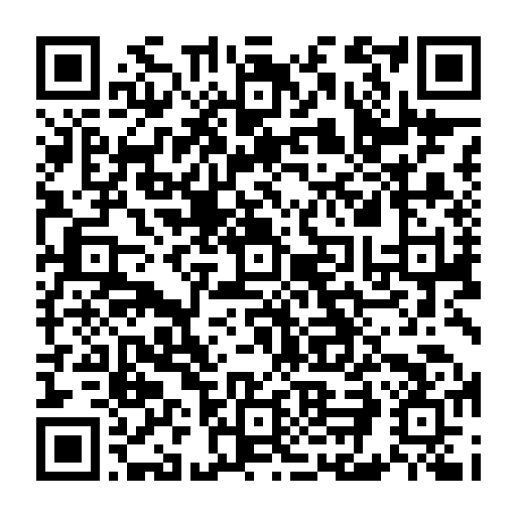

<div align="center">

# tabelhawhisper

**Local voice dictation for Linux: press a key, speak, text lands in your clipboard.**

**English** · [Português](README.pt-BR.md)

[](pyproject.toml)
[](https://github.com/astral-sh/uv)
[](LICENSE)

[](https://ko-fi.com/ianptkcs)

</div>

---

## What it is

Voice dictation plugin for
[DankMaterialShell](https://github.com/AvengeMedia/DankMaterialShell):
record audio, transcribe locally with
[faster-whisper](https://github.com/SYSTRAN/faster-whisper), copy to
clipboard — with a floating pill overlay and a transcription history widget.
No cloud, no API keys, everything runs on your machine.

## How it works

1. Press **Mod+E** to start/stop recording (wav mode records to file with
   pause support; streaming mode pipes audio with no pause).
2. A floating pill shows recording/paused/transcribing status with real-time
   wave bars (real PCM levels from the mic), timer, and controls.
3. Press stop to finish: faster-whisper transcribes locally and the text is
   auto-copied to the clipboard (plus DMS clipboard service and `wl-copy`).
4. Past transcriptions live in a history widget in the DMS bar (persistent
   ring buffer, click to expand and copy).

## Running locally

Requirements: Python 3.12+, PipeWire (`pw-record`), DankMaterialShell (for
the pill and history widget), `notify-send` and `wl-clipboard`.

```bash
git clone https://github.com/TAbelha/tabelhawhisper.git
cd tabelhawhisper
./install.sh
```

The installer syncs the uv environment (faster-whisper, numpy, etc.), sets up
the niri keybind wrapper (`Mod+E`), symlinks the DMS plugin, and creates the
config file at `~/.config/tabelha/tabelhawhisper/config.toml`.

## Development

The plugin is a **composite** DMS plugin with two components:

- **DictatePill.qml** (daemon): floating overlay with recording controls,
  wave bars, and transcription status.
- **HistoryWidget.qml** (bar widget): history icon in the bar, popout with
  expandable entries and copy.

## Changelog

See [CHANGELOG.md](CHANGELOG.md) for the version history.

## Support the project

- **Global**: [ko-fi.com/ianptkcs](https://ko-fi.com/ianptkcs)
- **Brazil (Pix)**: scan the QR below or copy the code

  

  <details><summary>Pix code (copy)</summary>

  ```
  00020126580014BR.GOV.BCB.PIX01365ad933b0-dcdc-4525-a736-0759902aeec65204000053039865802BR5925Ian Patrick da Costa Soar6009SAO PAULO62140510tQA85x6Dov63041FB6
  ```

  </details>

## License

[AGPL-3.0](LICENSE) — strong copyleft: you may use, modify and even host
tabelhawhisper commercially, but any modified version, including one running
as a network service (SaaS), has to stay open source under the same license.
